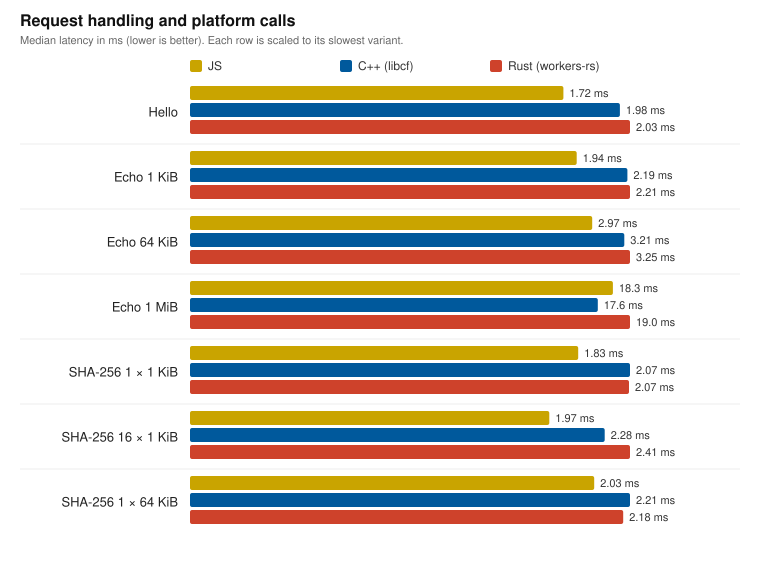
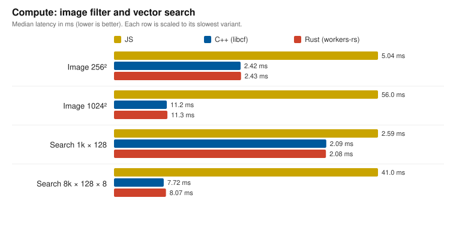
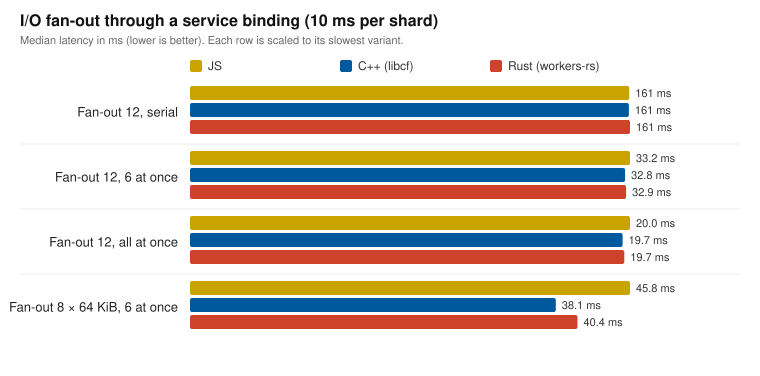
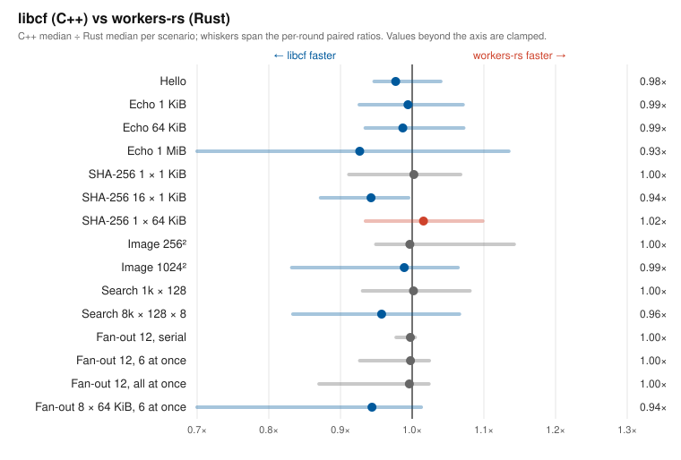

# C++ vs JavaScript benchmarks

**Just write JavaScript unless you have a good reason to use C++.**

Use libcf when you need existing C++ code, libraries, or expertise—not because
putting a Worker in Wasm automatically makes it faster. For request handling and I/O, JS is as fast or faster. For CPU-bound work, Wasm
(C++ or Rust) was 2–5× faster than JS in these scenarios. Measure your own
workload before choosing C++ for performance.

## Run locally

```sh
bazel run //:benchmark_sdk -- /tmp/libcf-benchmark.json
# Short diagnostic run:
bazel run //:benchmark_sdk -- /tmp/libcf-benchmark-smoke.json --rounds 2 --samples 5 --warmups 0
```

Bazel builds the fixtures before the runner starts. Each round starts all local Workers side by side and interleaves their samples in rotating order. The runner verifies every response and writes to the supplied new absolute report path (existing files are never overwritten). Compilation time is excluded and reported as `null` (schema 5). No Cloudflare credentials or network deployments are involved. The default suite separately verifies matching successful responses without timing thresholds.

All fixtures expose hello, binary echo, one/16 SHA-256 operations, compute and fan-out endpoints with the same request data, body bound, response bytes and content type. C++ uses the normal libcf coroutine/operation bridge. JS uses native Web Crypto directly and reads Content-Length bodies with `arrayBuffer()`, like the libcf runtime. All buffering, copies, allocations and client HTTP work remain in the latency measurements.

Default: six rounds; per scenario and round, at least 10 warmup requests and 300 ms of warmup per variant, then 80 measured sequential requests per variant. `--concurrency N` sends N simultaneous requests per sample; `--warmup-ms` sets the warmup duration. Reports include p95 and p99. The Rust fixture reads its query from the raw request URL, because `Request::url()` would link the `url` crate's IDNA tables, about 90 KB of gzipped Wasm. Each round starts fresh local runtimes; startup includes bundling and the harness's first response. This is not an edge cold-start measurement. Inputs must remain unchanged throughout the run or the runner refuses to emit mixed measurements.

## Rust comparator (workers-rs)

`bench/rust/` is the same fixture written against upstream [workers-rs](https://github.com/cloudflare/workers-rs) (`worker` 0.8.7). Bazel builds it hermetically, mirroring `worker-build --release`: rustc 1.98.0 with Cargo's default release profile (as in the workers-rs templates), wasm-bindgen 0.2.129 `--target module` with the reset-state and abort-handler options, and wasm-opt (binaryen 132) `-O` with worker-build's feature set. `bench/rust-worker.mjs` is worker-build's entry shim. Unlike worker-build, it is not pre-minified; every variant is bundled by the same harness. The default suite checks that all three variants return identical responses.

```sh
bazel run //:benchmark_sdk -- /tmp/libcf-benchmark.json      # JS, C++ and Rust, interleaved
bazel run //:benchmark_boundary_probe                         # JS<->Wasm calls per request (diagnostic)
```

## Compute workloads

`/image` and `/search` are CPU-bound workloads, where Wasm can help. They follow the published specification of [bitemyapp/workerd-compute-bench](https://github.com/bitemyapp/workerd-compute-bench). That project has no licence, so they are re-implemented here and no code is copied.

- `/image?w=&h=`: `w*h` grayscale bytes in, the same number out. A 5×5 binomial blur (the outer product of `[1,4,6,4,1]`, rounded half-up after both passes), then the Sobel magnitude `min(255, |gx|+|gy|)`. The outer three rows and columns are zero.
- `/search?n=&d=&q=&k=`: `n` int8 candidate vectors, then `q` query vectors, each of `d` values. For each query, the result is `k` records of `[id: u32 LE][score: i32 LE]`, by descending dot product, with smaller ids first on ties.

C++ and Rust use the same algorithms (separable blur, single-pass top-k) with the same explicit Wasm SIMD. Both are built at opt-level 3 with `simd128`. The JS fixture splits each phase into its own function. `bench/oracle.mjs` is a naive reference implementation that checks every response byte. Each compute case cycles through four payloads, so no variant can cache a result. The test suite also checks odd sizes (scalar tails), tie-heavy searches and invalid requests against all three variants. `search-large` uses 8,000 candidates rather than 32,768, to stay within libcf's 1 MiB request-body limit. Echo 64 KiB and echo 1 MiB are the transport controls for `image-256` and `image-1024`: they have the same request and response sizes, with no compute.

## I/O fan-out

`/aggregate?items=&parallel=&bytes=&delay=&seed=` is a gateway, adapted from the same project's I/O suite. It fetches `items` shards from a local origin Worker through an `ORIGIN` service binding, keeping at most `parallel` requests outstanding. Each shard waits `delay` ms at the origin before sending headers, like a slow upstream, then returns `bytes` deterministic bytes. The gateway returns `[seed][items]`, then `[id][bytes][FNV-1a checksum]` per shard (u32 LE), which the reference implementation checks.

- **JS:** `parallel` async lanes that take the next shard index.
- **C++:** one `ServiceBinding::fetch` per shard, awaited together with `cf::when_all(shards, parallel)`.
- **Rust:** `stream::iter(..).map(fetch).buffered(parallel)` from `futures-util`, which workers-rs already depends on.

Scenarios fetch 12 × 4 KiB shards serially, 6 at a time and all at once, and 8 × 64 KiB shards 6 at a time. Each variant has its own origin in the same local runtime. Workers documents a limit of six connections waiting for response headers per invocation; local workerd does not necessarily enforce hosted limits. The native Tokio servers and open-loop overload tests from the source project are not ported.

## Measured results

These are two consecutive full default runs (6 rounds × 80 samples per variant and scenario, 960 requests per variant and scenario in total) from a clean worktree, on 2026-10-22 UTC on an Apple M4 Pro under moderate background load (load average 4–8). All three variants run side by side, and each sample index requests every variant once in rotating order, so load drift falls on all variants alike.









| Scenario | JS (ms) | C++ libcf (ms) | Rust workers-rs (ms) | C++ vs Rust |
| --- | ---: | ---: | ---: | ---: |
| Hello | 1.723 | 1.983 | 2.030 | 0.98× |
| Echo, 1 KiB | 1.938 | 2.192 | 2.205 | 0.99× |
| Echo, 64 KiB | 2.974 | 3.211 | 3.254 | 0.99× |
| Echo, 1 MiB | 18.292 | 17.641 | 19.034 | 0.93× |
| SHA-256, 1 × 1 KiB | 1.827 | 2.071 | 2.066 | 1.00× |
| SHA-256, 16 × 1 KiB | 1.972 | 2.276 | 2.414 | 0.94× |
| SHA-256, 1 × 64 KiB | 2.032 | 2.212 | 2.178 | 1.02× |
| Image, 256 × 256 | 5.045 | 2.419 | 2.427 | 1.00× |
| Image, 1024 × 1024 | 55.973 | 11.198 | 11.324 | 0.99× |
| Search, 1,024 × 128, 1 query | 2.595 | 2.086 | 2.083 | 1.00× |
| Search, 8,000 × 128, 8 queries | 40.983 | 7.723 | 8.066 | 0.96× |
| Fan-out, 12 × 4 KiB, serial | 161.201 | 161.066 | 161.466 | 1.00× |
| Fan-out, 12 × 4 KiB, 6 at a time | 33.195 | 32.824 | 32.902 | 1.00× |
| Fan-out, 12 × 4 KiB, all at once | 20.003 | 19.665 | 19.743 | 1.00× |
| Fan-out, 8 × 64 KiB, 6 at a time | 45.824 | 38.093 | 40.355 | 0.94× |

Times are medians over all samples from both runs. The multiplier is C++ time divided by Rust time; below 1× means libcf is faster. Regenerate the charts from any reports with `bazel run //:benchmark_charts -- "$PWD/docs/images" /tmp/report-a.json /tmp/report-b.json`.

- **Compute is where Wasm pays off:** C++ and Rust are 2.1× faster than JS on `image-256`, 5.0× on `image-1024`, and 5.3× on `search-large`. For bridge-bound requests, JS remains as fast or faster.
- **libcf is never meaningfully slower than workers-rs.** Every scenario is between 0.93× and 1.02×. libcf is consistently ahead where bytes cross the boundary in bulk (1 MiB echo, 64 KiB shards, large search) and for sequential digests; elsewhere the two are within run-to-run noise.
- **Fan-out is bounded by the origin, not the bridge:** concurrency cuts 12 shards from 161 ms to 33 ms (6 at a time) or 20 ms (all at once) for every variant. With 64 KiB shards, JS is 20% slower than libcf, and workers-rs is 6% slower. Before `cf::when_all`, a C++ handler could only await shards one at a time.
- **Zero-filled request buffers:** libcf used to size each request body with `std::string::resize`, zero-filling up to 1 MiB that the host then overwrote. That cost about 0.8 ns per body byte and made large-body requests 9–11% slower than Rust. The internal bridge now builds as C++23 to use `resize_and_overwrite`; public headers remain C++20.
- **BYOB `readAtLeast` is no faster than `arrayBuffer()`** for Content-Length bodies: 1.70 vs 1.62 ms at 64 KiB, and 3.41 vs 3.33 ms at 1 MiB, in a direct local comparison. The source project's gain came from replacing a chunk-by-chunk reader, which libcf already avoids.
- **JS GC cliff:** the JS fixture originally buffered bodies with a doubling stream reader, which allocated about 3 MiB of short-lived buffers per 1 MiB request. In workerd, repeated `image-1024` requests then slowed 5–7× after about 47 requests and stayed slow; Node did not reproduce this. Reading Content-Length bodies with one `arrayBuffer()` allocation, as the libcf runtime and workers-rs do, removed it.

| Code shape | C++ (libcf) | Rust (workers-rs) |
| --- | ---: | ---: |
| Wasm, bytes (gzip) | 99,226 (38,196) | 247,576 (76,017) |
| Bundled JS, bytes (gzip) | 164,311 (29,996), whole libcf runtime | 46,567 (7,995) |
| Deployed total, gzip (per module) | 68,192 | 84,012 |
| Wasm imports / exports | 13 / 20 | 106 / 54 |
| Boundary calls, hello (imports + exports) | 1 + 4 | 28 + 10 |
| Boundary calls, one digest | 2 + 5 | 42 + 14 |
| Boundary calls, 16 digests | 17 + 20 | 252 + 74 |
| Boundary calls, image or search | 1 + 4 | 29 + 11 |
| Boundary calls, fan-out of 12 shards | 13 + 28 | 480–515 + 169–204 |
| Boundary calls, fan-out of 8 × 64 KiB shards | 9 + 20 | 1,892 + 597 |

The fixtures grew with the compute kernels, service binding and fan-out code; both variants carry the same features.

A request crosses the boundary as: two buffer requests, one call carrying method, URL, headers and body, and one result call that carries status, all response headers and the body. workers-rs calls a binding per JS object access. libcf's Wasm is about a third the size, but its runtime bundles adapters for every supported binding.

Copies per request: libcf reads a Content-Length body natively and copies it once, straight into the `std::string` that becomes `cf::Request::body`. It passes the response body to `Response` as a view of Wasm memory (one copy, inside the constructor). workers-rs copies `arrayBuffer()` into a `Vec` and copies again into the `Response`.

Digests: `SubtleCrypto::sha256/384/512` borrow a `std::span<const std::uint8_t>` (use `cf::bytes_of(request.body)` for text) and return an allocation-free awaitable. A dedicated host import passes Wasm memory directly to Web Crypto, and the 32–64 byte result is written to a static buffer. Unlike the general binding path, no `std::function`, shared state or reply allocation is involved. Binding replies on the general path are written in place into the pending operation instead of through a temporary `malloc`.

See [methodology and limitations](../docs/benchmarks.md). Each locally generated report includes raw samples, toolchain/host details, and source and artifact hashes. Generated reports are not committed. The incremental digest estimate is not a direct measurement of individual ABI instructions, and no throughput, memory or statistical-significance claim is made.
